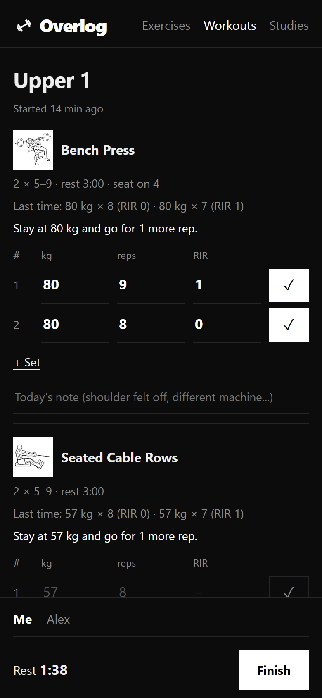
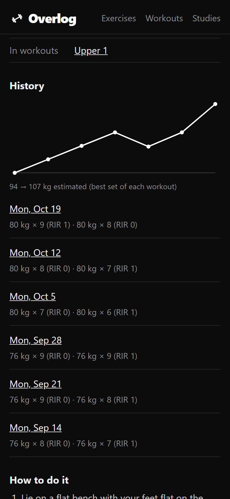
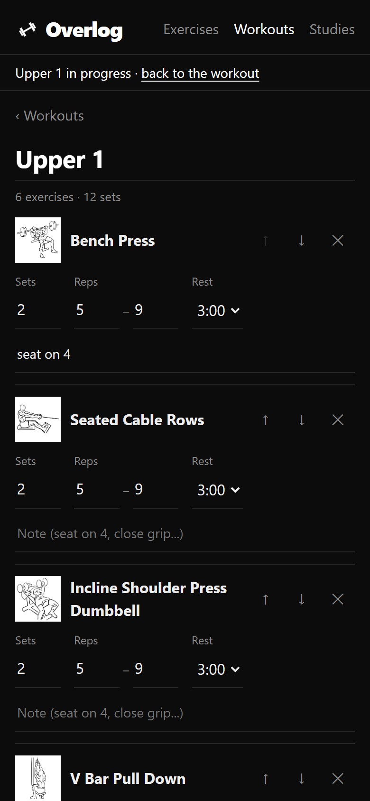
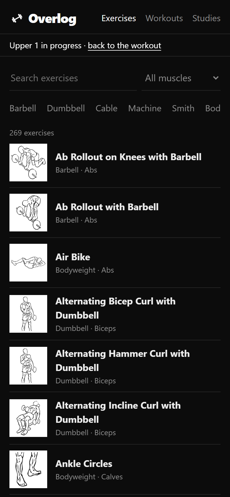
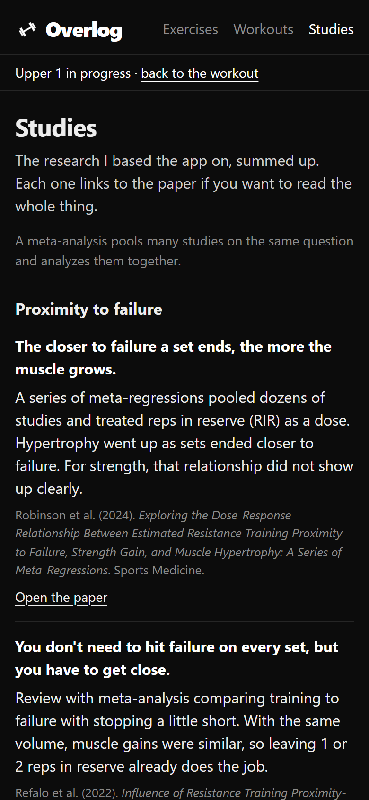

# Overlog

[](https://github.com/ViniciuscLemos/overlog/actions/workflows/deploy.yml)

Gym log I'm making for myself. Progressive overload + log.

It's live at https://viniciusclemos.github.io/overlog/. On the iPhone open it in Safari, Share > Add to Home Screen, and it works offline like an app.

I made it in Portuguese first because that's how I use it, and there's an English version of everything for the rest. The phone's language picks one, there's a switch at the bottom of the page, and https://viniciusclemos.github.io/overlog/?lang=en opens straight in English. The screenshots here are the English one.

<p>
  
  
  
  
  
</p>

## Why

I write down every set I do. The apps I tried were either paywalled (Hevy's free plan only saves 4 routines, so no ABCDE), needed internet in the gym, or were full of badges and streaks I don't care about.

Muscle grows when you train close to failure and keep adding weight or reps, so the app is built around that. Every set has weight, reps and RIR (reps left in the tank), next to what you did last time.

## What's there now

You start the next workout in the rotation and each exercise shows what you did last time and what to do today. The rule is double progression: stay on a weight until every set hits the top of the rep range, then go up by the smallest jump that equipment has (2 kg on a barbell or dumbbell, 5 kg on a machine). RIR covers the edge cases, so 3 or more reps left means get closer to failure first, and missing the bottom of the range at RIR 0 means the weight is too heavy.

An empty field takes last time's number when you tick the set, so repeating it is one tap. Everything saves as you go, so closing the app in the middle of a workout is fine. There's a rest countdown at the bottom (based on the clock, not a timer that iOS can pause) and the screen stays on.

After that there's a history of every workout, and each exercise gets a chart of its best set per session. That uses an estimated max so 80 kg x 9 and 82 kg x 7 can be compared.

Each exercise also takes a note for the day ("shoulder felt off", "machine 2 was taken") that shows up next time you do it.

You can also train with a partner on the same phone. Each person gets their own sets and their own "last time", and after each set it switches to the other one, since that's who goes next. At the end the app makes a file with only the partner's part, and they import it in their own Overlog, so their history stays theirs.

269 exercises with line drawings of the start and end of each movement (I didn't want photos). 236 already have the name we use in Brazilian gyms, like supino reto or remada cavalinho, and the search ignores accents and word order. Words like "rosca" or "halter" also find the ones that are still in English.

In the Workouts tab you set up your split, as many workouts as you want. They go in rotation instead of being tied to weekdays, so a 4-day upper/lower doesn't need to be Monday to Thursday. Each exercise starts at 2 sets of 5-9 reps with 3 min rest and you can change all of it, plus a note for stuff like seat height. It also counts sets per muscle, and an exercise's page shows which workouts it's in.

There's a Studies tab too with the papers I based the app on (failure, progression, volume, rest, protein...), summarized in plain words with the links. I checked every DOI.

Everything stays on the phone in IndexedDB, no account. Since that means clearing Safari's data loses it, the Workouts tab has a backup button that saves a JSON file (on the iPhone it opens the share sheet, so it can go to Files or iCloud) and restores it later.

## Next

Custom exercises, a sound when the rest is over, and offering to update the saved workout when I change something in the middle of one. The exercise steps from Everkinetic are only in English for now, so translating them is on the list too. The exercises without a drawing will get a black and white muscle map in the same style.

## How it's made

React and TypeScript with Vite. Dexie for IndexedDB, vite-plugin-pwa for the offline part, and Vitest for tests (the database ones run on fake-indexeddb). GitHub Actions runs lint, tests and build on every push and deploys to Pages.

The code is small: `src/lib` has the logic without React (search, workouts, progression, backup, the texts in both languages in `i18n.ts`), which is what the tests cover, and `src/components` has one file per screen. There's no router library, the pages are just `#/treinos/3` style hashes.

## Running it

```bash
npm install
npm run dev
npm test
```

`scripts/import-exercises.mjs` builds the exercise list from Everkinetic's data (instructions at the top of the file). Portuguese names are in `scripts/names-pt.json`.

## Credits

Exercises and drawings by [Everkinetic](https://github.com/everkinetic/data), under [CC BY-SA 4.0](https://creativecommons.org/licenses/by-sa/4.0/). The drawings load from their repo, and `src/data/exercises.json` keeps that license since it's made from their data. The rest is MIT.
